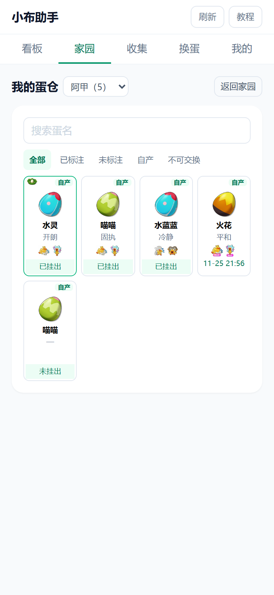
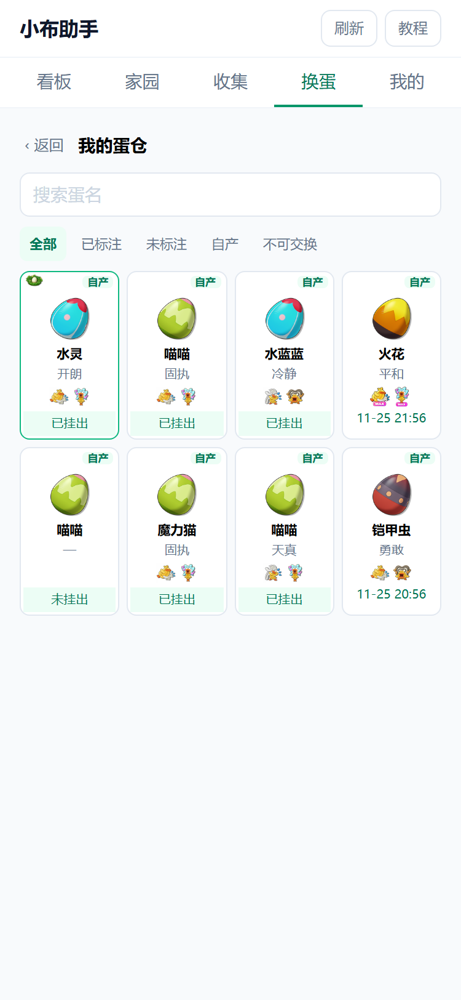

# 方案：换蛋广场的蛋仓 ↔ 家园的蛋仓，对齐角色选择（2026-11-25）

> 状态：**方案 / 待拍板**。本轮**没改 `src/`**（一行都没动）、没打包、没发版。
> 交付物：本文 + `docs/preview/U3-*.png`（375 / 390 各 8 张，含「返回」三个方向）+ 两张对比拼图 + 可交互预览
> `docs/preview/U3-蛋仓角色对齐-2026-11-25.html`（双击打开，顶部可切六屏）。
> 口径来源：用户 2026-11-25（U3）：「把换蛋广场的蛋仓与家园的蛋仓对齐角色选择」，先出方案 + 375/390 截图，确认后再写代码；
> 同日追加：「家园蛋仓与换蛋蛋仓的返回应该做得一致，这看上去变成两个页面了」→ 见 §10。

## 0. 一句话结论

**不是两套组件、也不是两份数据——是同一个 `EggStockPanel`，广场那边少传了 3 个 props、少了一段状态。**

家园蛋仓 `EggStockView` 自己算 `characters`（本机账号列表，第一个是主号）、自己管选中项、把下拉挂进标题行，再交给 `EggStockPanel`；广场蛋仓在 `EggMatchingHub.tsx:262` 只传了 `eggs / species / busy / mutate / collapsibleFilterRail / railBack`，`character` / `characters` / `onCharacterChange` 一个都没给，所以下拉那块（`EggStockPanel.tsx:181`）根本不渲染。

对齐 = **把家园那 23 行状态抽成一个 hook，两处都调它 + 广场补 3 个 props**。改动小：1 个新文件 + 3 处接线 + 测试，约 130 行（含测试），不碰服务端、不碰协议、不碰数据结构。

需要你拍板的 5 件事见 §7；其中有一条是硬限制：**需求单没有角色字段，所以「切换角色后需求跟着变」这一半做不到**，只能做到「可提供的蛋跟着变」。
另外用户 2026-11-25 追加的「两处蛋仓的『返回』要一致」单列在 **§10**：现状是家园把 `返回家园` 放页头最右、广场把 `‹ 返回` 放标题左边，确实像两个页面；推荐两边都改成 `‹ 返回 + 我的蛋仓 + 下拉`（只改家园一处）。

## 1. 现状（先看这两张图）

一页看完：[U3-现状vs改后-2026-11-25.png](preview/U3-现状vs改后-2026-11-25.png)（375 / 390 两行 × 家园现状 / 广场现状 / 广场对齐后）。

### 1.1 家园 · 我的蛋仓（有角色下拉）



- 「我的蛋仓」后面就是下拉：`阿甲（5）`，选项带每个角色的蛋数，**没有「全部角色」**（2026-11-24 口径，`64830cd`）。
- 默认落在本机账号列表的第一个（主号）；主号没蛋时网格里写「这个角色还没有蛋」，不会让人以为蛋丢了。
- 下面是 5 颗阿甲的蛋（含 1 颗家园蛋：火花，显示最后确认时间）。

### 1.2 换蛋 · 我的蛋仓（现状：没有角色下拉）



- 同一个面板、同一份库存，但**8 颗蛋全混在一起**：阿甲的 5 颗 + 阿乙的 3 颗（魔力猫 / 喵喵 / 铠甲虫）。
- 没有下拉，也没有「这个角色还没有蛋」这种提示位；筛选只有「全部 / 已标注 / 未标注 / 自产 / 不可交换」。
- 用户看到的问题就在这里：家园看的是「一个角色一屏」，广场看的是「所有角色一锅」，两处对不上。

### 1.3 图清单

| 文件 | 内容 |
| --- | --- |
| `preview/U3-{375,390}-现状-家园-有选角色.png` | 家园蛋仓现状（**主要对照·左**） |
| `preview/U3-{375,390}-现状-广场-没有选角色.png` | 换蛋蛋仓现状（**主要对照·右**） |
| `preview/U3-{375,390}-改后-广场-有选角色.png` | 对齐后：返回行里多出角色下拉 |
| `preview/U3-{375,390}-改后-广场-切到小号.png` | 切到阿乙（3 颗）：网格跟着变 |
| `preview/U3-{375,390}-改后-广场-该角色没有蛋.png` | 切到阿丙（0 颗）：「这个角色还没有蛋」 |
| `preview/U3-现状vs改后-2026-11-25.png` | 上面这些的拼图（两行三列） |
| `preview/U3-返回对比-2026-11-25.png` | 「返回」三个方向的对比（现状 / A / B+C，两列三行） |
| `preview/U3-{375,390}-返回A-家园-左侧返回.png` | 方向 A：家园返回收到标题左边 |
| `preview/U3-{375,390}-返回B-广场-右侧返回换蛋.png` | 方向 B：广场返回挪到最右、改成「返回换蛋」 |
| `preview/U3-{375,390}-返回C-家园-内容行.png` | 方向 C：家园蛋仓自己出内容行（页头隐藏） |
| `preview/U3-蛋仓角色对齐-2026-11-25.html` | 可交互预览：六屏切换 + 下拉真的能切 |

**截图是怎么来的（重要，别当成真机图）**：两处蛋仓都要「已登录 + 已入组 + 服务端有蛋」才出画面，本机没有组网环境。所以截图**不是** App 真机截屏，而是**用仓库里的真实组件**（`EggStockPanel` / `EggCharacterSelect` / `eggCharactersOf`）+ 一份假数据（阿甲 5 颗 / 阿乙 3 颗 / 阿丙 0 颗）渲染出来的：像素、文案、空态、`.egg-stock-*` 样式全部来自源码，只有数据和外壳（顶部标题 / 五个页签）是预览器补的。复现命令见 §8。

## 2. 查清：广场这边为什么没有角色选择

### 2.1 入口与组件

| | 家园蛋仓 | 换蛋广场的蛋仓 |
| --- | --- | --- |
| 入口 | 家园页顶栏「蛋仓」→ 页内一屏（`view === 'stock'`） | 换蛋页「蛋仓」按钮 → 页内一屏（`page === 'stock'`） |
| 屏组件 | `src/ui/plan/EggStockView.tsx`（`StockBody`，L103-168） | `src/ui/plan/EggMatchingHub.tsx`（L241 返回行 / L262 面板） |
| 面板 | `EggStockPanel`（同一份） | `EggStockPanel`（同一份） |
| 角色下拉 | `EggCharacterSelect` + `eggCharactersOf` | **没有** |

### 2.2 同一个面板，少三个 props

`EggStockPanel.tsx:92` 的签名里，角色三项都是可选的：

```ts
character?: string; characters?: readonly EggCharacter[]; onCharacterChange?: (key: string) => void;
```

面板内部两处用到：

- `EggStockPanel.tsx:140` 过滤：`(!character || e.gameAccountKey === character)`；
- `EggStockPanel.tsx:181-183` 下拉块：`characters && characters.length > 1 && onCharacterChange` 才渲染（且只在**横屏筛选栏** `rail` 里渲染）。

家园那边怎么给的（`EggStockView.tsx:117-135`）：

```ts
const [character, setCharacter] = useState('');
const myEggs = useMemo(() => (api.data?.state.eggs ?? []).filter((e) => e.accountId === me && e.status !== 'transferred'), [api.data, me]);
const characters = useMemo(() => eggCharactersOf(myEggs, snapshots), [myEggs, snapshots]);
const activeCharacter = character || characters[0]?.key || '';   // 首帧就落到主号，不闪「全部」
useEffect(() => { /* 换号 / 角色列表变了：选中的不在了就回第一个 */ }, [character, characters]);
```

广场那边（`EggMatchingHub.tsx:262`）：

```tsx
<EggStockPanel eggs={ownEggs} species={species} busy={api.busy} mutate={act}
  collapsibleFilterRail railBack={{ label: '返回换蛋', onClick: () => setPage(null) }} />
```

没有 `character` / `characters` / `onCharacterChange`，也没有 `eggCharactersOf` 调用 → 下拉不存在、过滤恒等于「全部角色」。**这是纯前端缺口，不是设计取舍。**

### 2.3 数据是不是同一份？——是，硬证据

- 两边同一个 hook 拿数据：`useEggMatching(groupId, me)`（`EggStockView.tsx:110`、`EggMatchingHub.tsx:44`），读的都是服务端 `state.eggs`（`WorkflowEgg[]`，带 `gameAccountKey`）。
- 两边同一套同步：`useEggStockSync`（家园 `EggStockView.tsx:111`、广场 `EggMatchingHub.tsx:91`），按本机每个游戏号分别推 `stock-sync`。
- 过滤口径逐字相同：家园 `accountId === me && status !== 'transferred'`（L119）＝ 广场 `ownEggs`（`EggMatchingHub.tsx:112`）。
- `EggStockView.tsx` 的注释自己写着：「和『组内广场 → 蛋仓』是同一份数据、同一个面板」。

> 所以 §「若广场那侧的蛋列表其实是另一份数据结构，先报我」这条**不成立**：没有第二份库存，不需要停下来。差异 100% 在 UI 接线。

### 2.4 顺带发现的第三个差异：空态文案

`EggStockPanel.tsx:206`：

```
eggs.length ? (character && !eggs.some(e => e.gameAccountKey === character) ? '这个角色还没有蛋' : '没有符合的蛋') : '暂无已采集的蛋'
```

家园有 `character` → 能出「这个角色还没有蛋」（`64830cd` 加的那句）；广场没有 → 只会出「没有符合的蛋」/「暂无已采集的蛋」。对齐后**这句自动一致，不用改文案**。

## 3. 对齐方案

### 3.1 推荐方案 A（小改动、纯接线）

1. **抽共用 hook**（别写两套）：新增 `src/ui/plan/useEggStockCharacter.ts`

   ```ts
   /** 蛋仓的角色筛选：角色列表 = 本机账号列表（第一个主号）+ 蛋上出现过的角色；默认第一个，无「全部角色」。 */
   export function useEggStockCharacter({ eggs, snapshots }: {
     eggs: readonly WorkflowEgg[]; snapshots: readonly AccountSnapshot[];
   }): { characters: EggCharacter[]; activeCharacter: string; setCharacter: (key: string) => void }
   ```

   内容就是把 `EggStockView.tsx:117-135` 那段原样搬进去（`eggCharactersOf` + 首帧默认 + 失效回落）。
   `EggStockView` 改成调用它（净减约 15 行，行为不变，现有 `EggStockView.test.tsx` 应保持全绿）。

2. **广场接线**：`EggMatchingHub.tsx` 里
   - 一行 `const { characters, activeCharacter, setCharacter } = useEggStockCharacter({ eggs: state.eggs, snapshots });`
     注意用 `state.eggs` + `useMemo` 而不是内联的 `ownEggs`（`ownEggs` 每次渲染都是新数组，会让 hook 里的 `useMemo`/`useEffect` 每帧重跑）。
   - 蛋仓返回行（L241）右边挂下拉，**竖屏**：

     ```tsx
     <div className="flex items-center gap-2">
       <Button variant="text" size="sm" onClick={() => setPage(null)}>‹ 返回</Button>
       <h3 className="min-w-0 shrink-0 text-sm font-semibold">我的蛋仓</h3>
       {characters.length > 1
         ? <EggCharacterSelect value={activeCharacter} characters={characters} onChange={setCharacter} testId="egg-stock-character-plaza" />
         : null}
     </div>
     ```

   - 面板补 3 个 props。**横屏**不用动布局：面板已有的 `rail` 分支会把下拉画进右侧筛选栏（`EggStockPanel.tsx:216`），和家园横屏一模一样。

3. **空态文案**：不需要改（见 §2.4），只要 props 传下去就自动变成「这个角色还没有蛋」。

4. **角色列表来源**：`eggCharactersOf(eggs, snapshots)`，`snapshots` 用广场已有的 `snapshots` prop（`GroupPlanHub` 从 `MotherGroupResources` 透传，和家园页是同一份本机导入数据）→ **顺序、主号、补漏规则与家园完全一致**。

### 3.2 备选方案 B（如果想让「我这一侧」全都跟着变）

在 A 的基础上，把撮合侧也按当前角色过滤：

- `myEggs`（`EggMatchingHub.tsx:118`，「我能给」索引）加 `e.gameAccountKey === activeCharacter`；
- 连带受影响：`supplyOf()`（广场卡上的「我能给蛋 / 我能孵」标签）、`onlyAffordable` 的可见性、接单详情「我能提供」列表、`peerEggs`、`autoReturnEggs`。
- 代价：切到没蛋的角色后，自己在广场上会看到一堆「接不了」，**但实际上你另一个角色可以接**——这正是本次要消除的「两边不一致」，只是换了个方向。所以不推荐，除非你明确要「一次只在一个角色上操作」。

### 3.3 明确做不到的一件：需求单跟着角色变

`EggDemand`（`src/shared/eggMatching.ts:7-19`）只有 `demanderAccountId`，**没有 `gameAccountKey`**；`createDemand` 也不收角色。所以：

- 「切换角色后**可提供的蛋**跟着变」→ 能（蛋带 `gameAccountKey`，方案 A 就够）；
- 「切换角色后**需求**跟着变」→ **做不到**，除非给需求单加角色归属（改 D1 表 + 接口 + 老数据兜底，见 §7 问题 1）。

### 3.4 别人看到的东西：一个字都不变（这条写进验收）

广场是给别人看的，但「别人能看到什么」的判定只在服务端字段上：

- 别人能看到的蛋 = `listed && available && 可交换`（`EggMatchingHub.tsx:113` 的 `offers` 要求 `e.listed`；`canCirculateEgg` = `status === 'available'` 且非异色 / 特殊蛋）。
- 角色下拉是**纯客户端过滤**：不发 `mutate`、不改 `listed` / `status` / `location`，不写 localStorage，更不写库。
- 结论：**同一个人换成别的角色看，别人眼里的「他能给什么」完全不变；别人也看不到「你现在选的是哪个角色」。**
- 附带确认：切换角色也不会把蛋从服务端「藏起来」——只是本机这一屏不画它们。

## 4. 改动量

| 档位 | 范围 | 文件 | 行数（含测试） | 风险 |
| --- | --- | --- | --- | --- |
| **小（推荐 = 方案 A）** | 只对齐蛋仓页 | 新增 `useEggStockCharacter.ts`；改 `EggStockView.tsx`、`EggMatchingHub.tsx`；测试 `EggMatchingHub.test.tsx` + 新 hook 测试 | **约 130 行** | 低。纯接线，不动服务端 / 协议 / 数据结构；回退 = 删 3 个 props |
| 中（方案 B） | A + 撮合侧按角色过滤 | 再动 `myEggs` / `supplyOf` / `peerEggs` / `autoReturnEggs` | 约 200~260 行 | 中。要防止「切错角色导致自己接不了单」，得补一组回归测试 |
| 大（需求单按角色） | 需求也要分角色 | `functions/schema.sql` + D1 迁移、`createDemand` / `applyEggAction` 校验、`api/eggMatching` 兼容、广场需求卡标注、老数据默认值 | 约 400+ 行 + 迁移窗口 | 高。老客户端发的 publish 没有该字段，必须给默认值；不建议和 UI 对齐混在一轮 |

**推荐先做「小」**，把两边的显示口径对齐；「需求要不要分角色」单独决策。

## 5. 会不会影响换蛋成交、挂出、自动挂出

| 链路 | 影响 | 依据 |
| --- | --- | --- |
| 换蛋成交（发起 / 接受 / 确认） | **不影响** | 方案 A 不过滤 `myEggs`、`offers`、`autoReturnEggs`；成交动作只认 `giveId` / `line`，与界面筛选无关 |
| 挂出 / 取消挂出 | **不影响** | 写的是蛋自己的 `listed`（`applyEggAction({type:'list'})`）；筛选不改写、不上报 |
| 自动挂出 | **不影响** | `autoListStock(state, accountId, gameAccountKey)`（`eggWorkflow.ts:159`）由同步 / 机器人上报链路按**每个游戏角色**分别跑（`useEggStockSync.ts:63-102` 也是逐快照推），和界面选中的角色无关 |
| 别人看到的可换列表 | **不影响** | 见 §3.4：只看服务端 `listed && available` |
| 广场「蛋仓 N」角标 | 建议**不动**（= 全部角色的蛋数） | 若跟着角色变，会出现「角标 5、下拉里阿乙（3）」这种对不上的观感；选项里每个角色已经带自己的蛋数 |
| 蛋仓页内的搜索 / 筛选 | 不影响 | `visible` 的过滤顺序不变，只是在 `character` 之后再叠加原有条件 |

## 6. 建议的验收（写代码那一轮）

1. 广场 → 蛋仓：有 2 个以上角色时标题行出现下拉，默认主号；只有 1 个角色时**不出现**（与家园一致）。
2. 切到小号：网格只剩小号的蛋（张数 = 下拉里的蛋数），横屏切到筛选栏里的下拉，行为相同。
3. 切到一个没蛋的角色：网格写「这个角色还没有蛋」（不再写「没有符合的蛋」）。
4. 「蛋仓 N」角标不随角色变化。
5. 别人视角：切换角色后，组内广场 / 接单详情里「谁能给」的判定与切之前一致（用两份账号的本地数据手测一遍）。
6. 现有 `EggStockView.test.tsx`、`EggStockPanel.test.tsx`、`EggMatchingHub.test.tsx` 全绿，另补：`useEggStockCharacter` 3 条（默认主号 / 选中项失效回落 / 单角色不展示）。

## 7. 需要你拍板的 5 件事

1. **需求单要不要也按角色分？** 现在 `EggDemand` 没有角色字段，所以「切角色后需求跟着变」做不到。建议这轮只对齐蛋仓，需求分角色单开一轮（改动量「大」，要迁移）。→ 选：只对齐蛋仓 / 单开一轮做需求分角色。
2. **撮合侧要不要跟着过滤？** 推荐**不过滤**（方案 A）：否则切到没蛋的角色，自己会看到「我暂时给不了」，但别的角色明明能给，会误导。→ 选：不过滤（推荐）/ 过滤（方案 B）。
3. **广场「蛋仓 N」角标**：保持全部角色总数（推荐）/ 显示当前角色蛋数。
4. **选中的角色要不要记住？** 家园现在不记（离开再进来回到主号）。建议广场也不记、两边各自独立——一致、无额外状态。→ 选：不记（推荐）/ 两边共用一份并记住。
5. **两处蛋仓的「返回」走哪个方向（2026-11-25 追加）？** 推荐**方向 A**：两边都 `‹ 返回 + 我的蛋仓 + 下拉`。详见 §10。→ 选：A（推荐）/ B（右侧「返回换蛋」）/ C（家园也改成内容行）/ 先不动。

## 8. 复现与产物位置

```powershell
# 生成可交互预览（真实组件 + 假数据，单文件、双击可开）
node tools/preview/u3/build.mjs
# → docs/preview/U3-蛋仓角色对齐-2026-11-25.html

# 截 375×812 / 390×844 两档、八屏（deviceScaleFactor=2）
node tools/preview/u3/shot.mjs
# → docs/preview/U3-<宽>-<屏>.png

# 拼成对比图
node tools/preview/u3/compose.mjs
# → docs/preview/U3-现状vs改后-2026-11-25.png
node tools/preview/u3/compose-return.mjs
# → docs/preview/U3-返回对比-2026-11-25.png

# 冒烟：双击打开（file://）也能出图
node tools/preview/u3/check-standalone.mjs
# 卡片 5  图片 14/14 加载成功  控制台错误 0
```

本轮实际输出（照抄命令结果）：

```
[u3] docs\preview\U3-蛋仓角色对齐-2026-11-25.html  1325 KB
375  现状-家园-有选角色       卡片 5  角色下拉 1  「没有蛋」提示 0  横向溢出 无
375  现状-广场-没有选角色      卡片 8  角色下拉 0  「没有蛋」提示 0  横向溢出 无
375  改后-广场-有选角色       卡片 5  角色下拉 1  「没有蛋」提示 0  横向溢出 无
375  改后-广场-切到小号       卡片 3  角色下拉 1  「没有蛋」提示 0  横向溢出 无
375  改后-广场-该角色没有蛋     卡片 0  角色下拉 1  「没有蛋」提示 1  横向溢出 无
390（同上五屏，数字一致）
```

- 预览器源码在 `tools/preview/u3/`（`main.tsx` / `build.mjs` / `shot.mjs` / `compose.mjs` / `tailwind.config.js` / `icons/`），只引用 `src/` 的组件，**不改 `src/`**。
- `shot.mjs` 会在 127.0.0.1 随机端口起一个只读静态服务（`public/ui/*` 的图标在 `file://` 下会 404），进程退出即关。
- 设计资产台账：`docs/preview/U3-蛋仓角色对齐-2026-11-25.html` **没登记**。`node scripts/design-assets.mjs --check` 目前已经是红的（U2 的方案稿等 8 份未登记，属既有状态），本轮没有顺手改台账，避免扩大改动面。

## 9. 一句话复述

家园那套「一个角色一屏 + 下拉带蛋数 + 没蛋也有提示」已经做对了，广场只是没接上同一套线；**接上去是 130 行以内的纯前端改动，不碰成交、挂出、自动挂出，也不改别人能看到什么**。需求单要不要按角色分，是另一个量级的决定，等你拍。

## 10. 追加：「返回」两处不一致（2026-11-25 用户反馈）

> 用户原话：「家园蛋仓与换蛋蛋仓的返回应该做得一致，这看上去变成两个页面了」。
> 截图见 [U3-返回对比-2026-11-25.png](preview/U3-返回对比-2026-11-25.png)（两列三行：现状 / 方向 A / 方向 B+C）。

### 10.1 现状：同一件事两种写法

| | 家园蛋仓 | 换蛋 → 我的蛋仓 |
| --- | --- | --- |
| 竖屏返回 | `返回家园` **边框按钮，页头最右**（`Home.tsx:556-565`，`home-view-nests`） | `‹ 返回` **文字按钮，标题左边**（`EggMatchingHub.tsx:253`） |
| 竖屏标题 | `我的蛋仓` 在页头左侧（`Home.tsx:522-532`），**页头常显**（sticky） | `我的蛋仓` 在内容第一行，**随内容滚走** |
| 横屏 | 右侧纵向标题栏：`返回家园 / 我的蛋仓 / 收起筛选` | 右侧纵向标题栏：`返回换蛋 / 我的蛋仓 / 收起筛选` |

**横屏其实已经一致**（同一套 `.egg-stock-rail-back`，只是文案不同），所以这次只处理竖屏这一行；横屏那条 `header[data-testid="home-header"][data-view="stock"] { display: none }`（`index.css:563`）说明家园蛋仓屏横屏根本不显示页头。

### 10.2 三个方向

| 方向 | 做法 | 截图 | 改动量 | 代价 |
| --- | --- | --- | --- | --- |
| **A（推荐）** | 两边都 `‹ 返回  我的蛋仓  [角色下拉]`，返回是**文字按钮在左** | 家园 `U3-{375,390}-返回A-家园-左侧返回.png`；广场 `U3-{375,390}-改后-广场-有选角色.png` | `Home.tsx` 约 10 行（蛋仓屏的返回并到标题左边，右侧那个只在「接单上窝」保留）；广场那行本来就是左返回，`0` 行 | 点击区比边框按钮小一点；家园失去「返回家园」这四个字的目的地提示 |
| B | 两边都 `我的蛋仓 [下拉] …… 返回换蛋`（**右边框按钮**） | `U3-{375,390}-返回B-广场-右侧返回换蛋.png` | `EggMatchingHub.tsx` 一行（约 5 行） | **语义坑**：广场蛋仓今天多了个入口——「我的 → 蛋仓」直达（U2 正在改，`openStock`）。从那儿进来写死「返回换蛋」是错的；`‹ 返回` 才不挑入口 |
| C | A + 家园蛋仓不再用页头，自己出内容行 | `U3-{375,390}-返回C-家园-内容行.png` | `Home.tsx` 隐藏蛋仓屏页头（约 12 行）+ `Home.test.tsx` 跟着改 | 标题和下拉会随内容滚走，不再常显；另外家园的「接单上窝」仍是页头式，家园内部会再多一处不一致（除非一起改） |

**推荐 A**：只动家园一侧，广场那边不用改；「‹ 返回」不挑入口（换蛋列表 / 我的 两个入口都能回去）；横屏零影响。C 看着最像「同一个页面」，但代价是标题常显丢掉、家园内部又出现一处不一致。

### 10.3 还有一处不同（这次没动，要不要一起对齐你定）

家园蛋仓外面套了一层白卡（`EggStockView.tsx:210` 的 `<section className={CARD}>`），广场是直接铺在灰底上——现状图里左边内容有白底圆角、右边没有。要完全一样，可以给广场也套白卡，或把家园那层去掉（二选一，各有取舍，不建议顺手改）。

### 10.4 选 A 之后怎么落（实现要点，供下一轮写代码用）

1. `Home.tsx`：`view === 'stock'` 的标题分支最前面插 `‹ 返回`（**保留 `data-testid="home-view-nests"`**，`Home.test.tsx` 里已有的点击 / 断言路径都不用改），并把右侧那个 `返回家园` 收窄成只在 `view === 'demands'` 时渲染（现在那段是 `nests ? 接单上窝 : 返回家园` 两分支）。
2. `EggMatchingHub.tsx`：`page === 'stock'` 的返回行保持 `‹ 返回`，把角色下拉加进这一行（§3.1）。
3. 横屏：不动。两侧标题栏文案仍是「返回家园 / 返回换蛋」——**要不要连横屏也统一成「返回」，单独确认**（涉及 2×2 折行变一行）。
4. 顺带要报的一个问题（不在本轮改）：从「我的 → 蛋仓」进来后点 `‹ 返回` 会回到**换蛋页**，不是「我的」页（`setPage(null)` 是写死的）。U2 那条入口要么自己接管返回目标，要么这一轮先不暴露这个入口。

## 11. 落地记录（2026-11-25 晚）

### 11.1 已经进了 `e852b99`（和 U2 的「我的」页同一批）

- **新增** `src/ui/plan/useEggStockCharacter.ts`（+ `useEggStockCharacter.test.tsx` 5 条）：家园 / 广场共用的角色筛选；默认主号、主号 0 蛋也在、选中项失效回落、空列表不出下拉、与 `eggCharactersOf` 同一份口径。
- `EggStockView.tsx` 改调这个 hook（删掉重复的 23 行状态，行为不变）。
- `Home.tsx` **方向 A**：蛋仓屏的 `‹ 返回` 挪到标题行最左，`data-testid="home-view-nests"` 原样保留；页头右侧的「返回家园」只剩「接单上窝」那一屏用。`Home.test.tsx` 一行没改，22 条全绿。
- `EggMatchingHub.tsx`：新增 `onStockBack` / `stockBackLabel`，把写死的 `setPage(null)` 换成 `leaveStock()`（**默认仍回换蛋页**）；`GroupPlanHub.tsx` 透传这两个参数。
- **新增** `EggMatchingHub.stockBack.test.tsx`（4 条，含「从我的进、返回回我的」）。

### 11.2 本轮补的最后一段（本次提交）

- `App.tsx`：`navigation.eggStockFromProfile` 为真时，给换蛋页传 `onEggStockBack = () => navigate({ type: 'tab', page: 'profile' })`。
- `CollectionGroups.tsx`：接住 `onEggStockBack` 并透传给蛋仓屏，横屏标题栏文案跟着变「返回我的」。

→ 于是 **「我的 → 蛋仓 → 返回」回到「我的」**，不再掉到换蛋页；**从换蛋页自己点「蛋仓」进来仍是回换蛋页**（默认行为没变）。

### 11.3 还没做（等 A 说合）

- **广场蛋仓的角色下拉接线**：hook 已就绪，只差把 `EggStockPanel` 的三个 props 接上 + 返回行挂下拉——按 A 的冲突提醒，等 `EggStockPanel` / `Home` / `EggMatchingHub` 三方改动合流后再切。
- §10.3 的白卡差异：用户已确认**先不动**。

### 11.4 验证（照抄命令输出）

```powershell
npx vitest run src/ui/plan/EggMatchingHub.stockBack.test.tsx --reporter=verbose
 ✓ 从「我的」进蛋仓：点返回回「我的」（调用方给的去向），不掉回换蛋页
 ✓ 没传去向时返回仍然回换蛋页（现有行为不变）
 ✓ 「我的换蛋」那屏的返回不受影响，始终回换蛋页
 ✓ 从「我的」进蛋仓：点返回真的回到「我的」（去向由入口接管，不掉回换蛋页）
 Test Files  1 passed (1)
      Tests  4 passed (4)

npx vitest run src/ui/navigation.test.ts src/ui/Profile.test.tsx src/ui/plan/EggMatchingHub.test.tsx src/ui/plan/EggMatchingHub.stockBack.test.tsx src/ui/Home.test.tsx src/ui/plan/EggStockView.test.tsx src/ui/plan/useEggStockCharacter.test.tsx
 Test Files  7 passed (7)
      Tests  111 passed (111)
```

`npx tsc -b`：我这几个文件 0 错误。工作区里 `fitCardName.test.tsx` / `EggGroupRows.test.tsx` / `eggStockGroups.test.ts` 的报错来自**别的会话在途文件**（引用还没落地的模块），与本轮改动无关。
