# 方案 · 自定义头像（AV1，2026-11-28）

> **状态：已落地（2026-11-28 用户拍板：A 图鉴精灵 + 云端 + 点头像直接换；B 上传图不做）。**
> 实现见 §12；下面的 A/B/C 与推荐是拍板前的方案记录，保留不改。
>
> 只出方案阶段没有写实现。用户原话：「这个加入用户自定义头像功能」。
> 截图 16 张在 `docs/preview/AV1-*.png`；可交互原型在 `docs/preview/AV1-自定义头像-2026-11-28.html`（双击可开）。
> 本轮不改 `src/`、不打包、不发版；等确认后再落代码。

## 一句话结论

**做 C（图鉴精灵 + 上传照片），头像存云端，但分两期：先 A，再 B。**
用户倾向的「C + 存云端」我同意；需要修正两点（见 §6）：**「默认取图鉴精灵」对没导入过数据的新用户不成立**，
以及**「存云端」不是加个 localStorage 键就完事**——现有同步只有「云端覆盖」和「只补本机缺的键」两种合并规则，
头像必须走带时间戳的成对键，否则换设备会被旧头像顶掉。

## 1. 现状（事实，不是印象）

| 事实 | 证据 |
| --- | --- |
| 概览卡头像是 44px 圆 + 名字首字，已登录 emerald、未登录 slate 的「本」 | `src/ui/ProfileHeader.tsx:51-59` |
| 头像不是独立组件，也没有跨页面复用口径 | 同上；`src/ui/kit/` 只有 Card / Row / Chip / Section / Skeleton / EmptyState，没有 Avatar |
| 本机只存令牌、账号 id、云端版本，**没有用户名**，用户名只能读 `/api/me` | `src/api/session.ts:10-13`、`:47-56` |
| 云端快照是一整份 gzip+base64，每次同步整份上传；偏好以字符串键放进 `prefs` | `src/api/sync.ts:92-111`、`:124-145` |
| 偏好合并：口径类 4 个键云端优先，其余**只补本机没有的键** | `src/api/sync.ts:224` |
| 已有「按修改时间合并」的先例（推荐性格覆盖表） | `src/api/sync.ts:204-219` |
| 精灵立绘已有统一取图与兜底：官方 CDN 256×256 透明 PNG | `src/domain/petAvatar.ts`、`src/ui/PetAvatar.tsx` |

**P1-02 已修**（本轮 ①，commit `ff766e3`）：概览卡与「我的身份」行现在都显示用户名；读不到时仍写「已登录」；
用户名与账号面板共用一份 `/api/me` 缓存，同时挂载只发一次请求。头像方案可以直接复用这份缓存。

现状截图（375 / 390）：

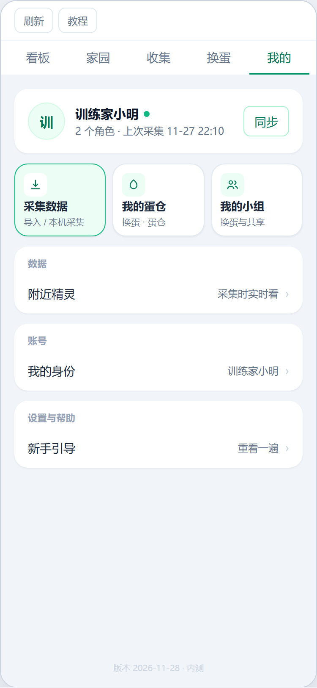
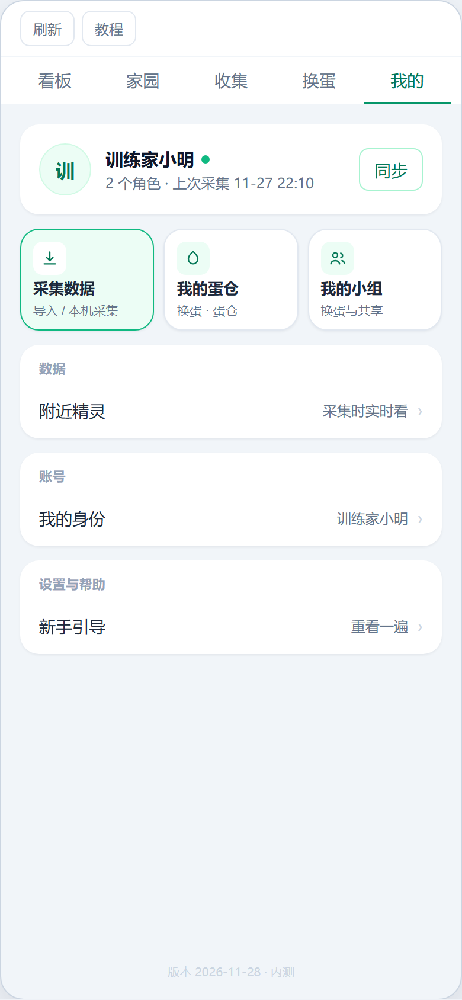

## 2. 方案 A · 从图鉴选一只精灵


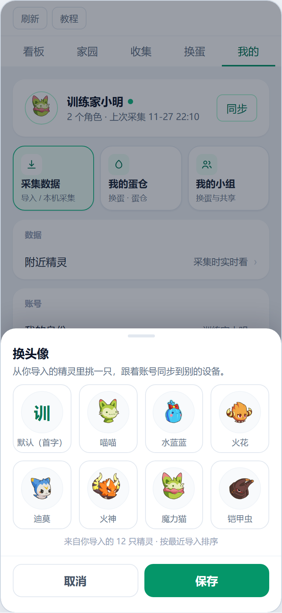

390 版：[首页](preview/AV1-390-A1-我的首页-精灵头像.png)、[选精灵](preview/AV1-390-A2-选精灵-宫格.png)。

**交互**：点「我的身份 · 资料 · 头像」或概览卡头像 → 底部面板「换头像」→ 从**你已导入的精灵**里挑一只
（按最近导入排序，去重到形态）→ 保存。第一格永远是「默认（首字）」，用来反悔。
没导入过数据时面板给一句「还没有导入精灵，先用名字首字」，不空着。

**存储**：只存一个短字符串 `pet:<gameId>`（约 10 字节），随账号同步，换设备也在。

**成本**：约 1～1.5 人日。
- `src/ui/kit/Avatar.tsx`：新增原语（sprite / photo / initial 三种形态，44 与 64 两档；DESIGN1 的原语层，不另写一套）；
- `ProfileHeader` 换成 `<Avatar>`；新增「选精灵」底部面板 + 从快照取已导入精灵（复用 `useSnapshots`）；
- 同步：新增成对键（见 §5）+ 4～6 个测试（有用户名/无用户名/未导入/选精灵/反悔/同步合并）。

**取舍**：零上传、零裁剪、零存储风险，复用现成资产与兜底；缺点是「只能选精灵」，用户想要自己的脸就没戏，
而且头像辨识度取决于立绘（小尺寸下有些精灵是一团颜色）。

## 3. 方案 B · 上传自己的照片

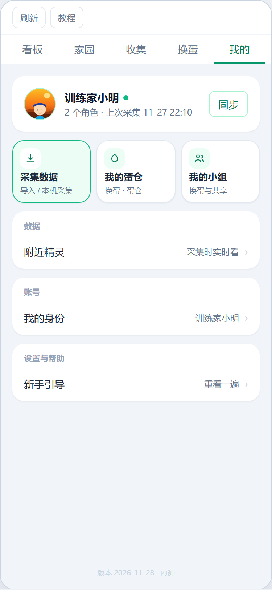
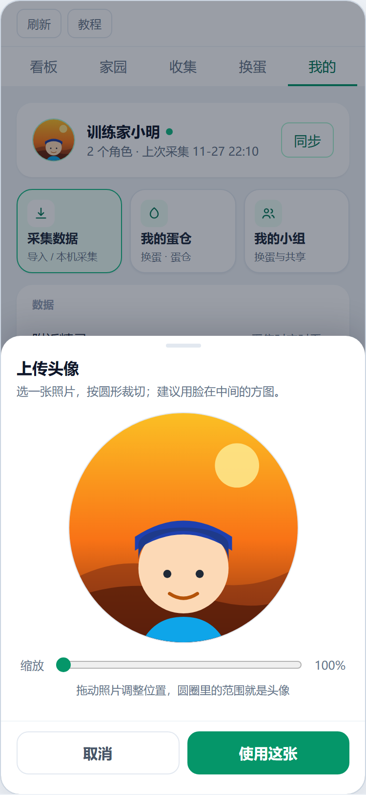

390 版：[首页](preview/AV1-390-B1-我的首页-上传照片.png)、[裁剪](preview/AV1-390-B2-上传-圆形裁剪.png)。

**交互**：同入口 → 面板里「从手机相册上传」→ 选图 → 圆形裁剪（拖动 + 缩放）→ 使用这张。

**存储**：压缩后的图片以 data URL 存偏好键，随账号同步。
建议口径：**128×128 WebP（质量 0.8）**，目标 ≤ 8KB，硬上限 24KB；超限提示换一张。
显示只有 44px（2× = 88px），128 足够，不需要原图。

**成本**：约 2～2.5 人日（B-1 硬切 1～1.5 + 裁剪器 0.5～1）。
- 文件选择 + `createImageBitmap` + canvas 压缩（含 iOS EXIF 方向，`imageOrientation: 'from-image'`）；
- 裁剪器：指针拖动、双指/滑杆缩放、边界限制；或先做 B-1「居中方图硬切 + 圆形遮罩」省掉这一层；
- 存储与同步键同上；空态、压缩失败、超限、权限拒绝四种失败态各要一句文案。

**取舍**：最像「自己的账号」；代价是上传链路、裁剪交互、图片体积/同步体积、安卓壳里的文件选择都要验。
44px 下裁剪器带来的收益有限——**这是我认为可以先砍的部分**（见 §6）。

## 4. 方案 C · 两者都支持（推荐）

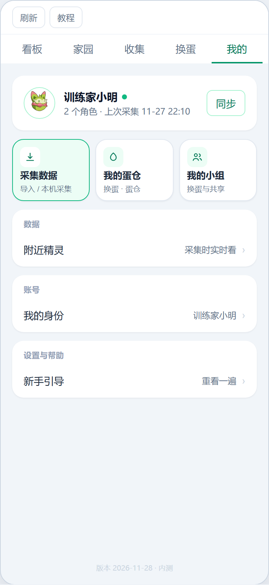
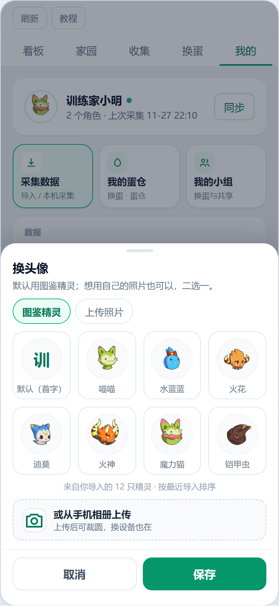

390 版：[首页](preview/AV1-390-C1-我的首页-两者都支持.png)、[面板](preview/AV1-390-C2-头像面板-两个来源.png)。

**交互**：一个面板两个来源，「图鉴精灵 / 上传照片」页签；默认落在图鉴页签，底部一行「或从手机相册上传」
是次要路径。默认值仍是名字首字，选过精灵或传过照片才替换。

**成本**：A + B + 约 0.5 人日整合（页签、默认值、值格式判别、迁移）。

**取舍**：功能完整、用户不将就；风险是两个来源都要维护，照片的存储/同步问题一样逃不掉。
**分期落地**：第一期只上 A（面板里不出现「上传照片」页签），第二期再加页签——这样第一期不会留一个死入口。

## 5. 存储与同步：别小看这一步

头像不是普通偏好，它有两个特殊性：**换设备要跟着走**、**改了要能覆盖旧值**。

现状的合并规则（`src/api/sync.ts:199-228`）：
- `CLOUD_WINS_PREF_KEYS` 里的 4 个键：以云端为准；
- 其余键：**只补本机没有的**。

如果只加一个 `roco.profileAvatar` 到 `SYNCED_PREF_KEYS`，结果是：B 设备已经有一个旧头像 → 同步永远只补缺 →
A 设备改的新头像推不上去（B 端被旧值挡住）。反过来放进 CLOUD_WINS，则「本机刚改完还没推」时会被云端旧值覆盖。

**建议口径**（照抄推荐性格覆盖表的做法，`src/api/sync.ts:204-219`）：

| 键 | 值 | 说明 |
| --- | --- | --- |
| `roco.profileAvatar` | `pet:3007` 或 `photo:<data-url>` | 当前头像；没有这个键 = 首字默认 |
| `roco.profileAvatarUpdatedAt` | 毫秒时间戳 | 与上一行成对读写，合并时按时间新的赢 |

- 两个键都进 `SYNCED_PREF_KEYS`，但**不走**「只补缺 / 云端优先」，走时间戳比较；
- 服务端不需要改：`prefs` 本来就是 `Record<string, string>`；
- 退出登录不清头像（它是账号资料，不是会话）；本机未登录时读不到云端，显示首字，登录后同步回来；
- 值格式不认识（精灵被下架、图片解不开）→ 静默回退首字，不要把面板弄崩。

**体积**：精灵 id 可忽略；照片 data URL 会进入**每次同步的整份快照**。目标 ≤ 8KB 时影响不大，
超过 24KB 就不该进同步了——这是 §6 里建议给 B 设上限、并预留「照片只存本机」退化方案的原因。

## 6. 对用户倾向的两点修正

1. **「默认取图鉴精灵」要改成「默认首字」。**
   新用户还没导入数据，图鉴是空的；默认必须是一个不依赖数据的值。建议：
   已登录 = 用户名首字 + 8 色语义底色（hash 用户名取色，替换现在写死的 emerald）；
   老账号没用户名 = 「已」；未登录 = 「本」+ slate。选了精灵/照片再替换，随时可以选回「默认（首字）」。

2. **「存云端」对精灵几乎免费，对照片要设上限。**
   精灵 ID 走时间戳成对键即可；照片建议 128px WebP、≤ 8KB（硬上限 24KB）。如果实测同步变慢或弱网反馈差，
   B 退化成「云端只存精灵头像，照片只存本机并明说换设备要重设」——这个决策点放在第二期开工前定。

另外我认为**上传裁剪器可以晚一点做**：显示尺寸只有 44px，居中方图 + 圆形遮罩已经能用；
裁剪器（拖动/缩放）是第二期里的可选项，多 0.5～1 人日。截图里的 B2 展示的是完整版，方便比较。

## 7. 入口：两处都要，但头像上不挂角标

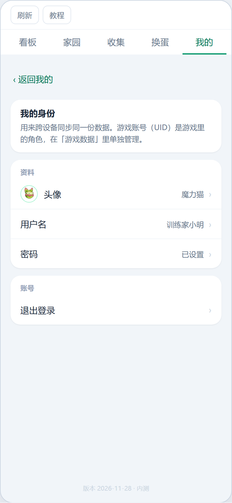
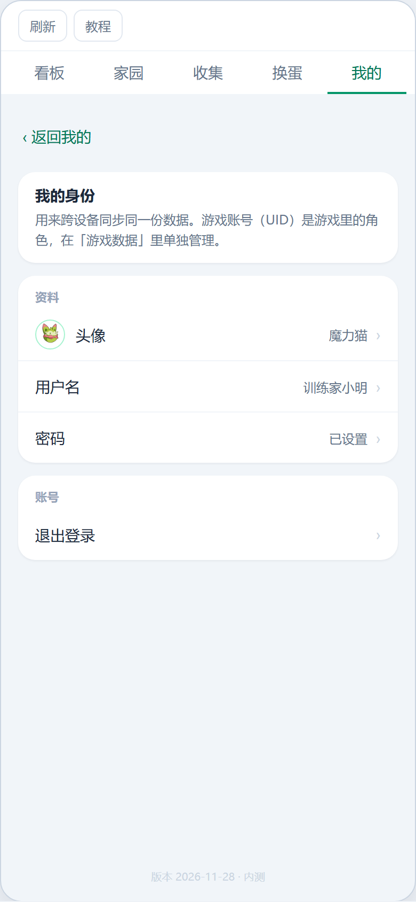

- **「我的身份」新增「资料 · 头像」一行**（带 28px 小预览 + 当前值）：可发现、可回退，是主入口；
- **点概览卡头像**也是入口：快捷，但不作为唯一入口；
- **不在头像上挂相机/铅笔角标**：44px 里压一个角标会盖住精灵立绘（试过，像立绘上多了一块），视觉噪音大于收益。

## 8. 要定的口径（一张表）

| 要定的 | 建议 | 理由 |
| --- | --- | --- |
| 头像来源 | C：先 A 后 B | 兼顾覆盖面与成本；第一期不做死入口 |
| 存储 | 云端，带时间戳成对键 | 多账号 + 跨设备是既有能力，只存本机等于换手机就丢 |
| 尺寸 | 显示 44px；上传压到 128×128 WebP | 2× 屏 88px，128 足够；控制同步体积 |
| 裁剪 | 第一期居中硬切；裁剪器列为 B 可选项 | 44px 下裁剪器收益有限 |
| 默认头像 | 用户名首字 + 8 色语义底色；无用户名「已」；未登录「本」 | 不依赖图鉴数据；和用户名口径一致 |
| 入口 | 「我的身份 · 头像」行 + 点头像 | 可发现 + 快捷；不挂角标 |

## 9. 分期与验收

> 落地时按 §12 执行（只做 A；入口只留头像本身；改用「立即 PUT」而不是时间戳成对键）。

**第一期（A，约 1～1.5 人日）**
- `kit/Avatar` 原语 + `ProfileHeader` 接入；「我的身份 · 头像」行；选精灵面板；时间戳成对键同步。
- 验收：换精灵后概览卡与账号行都变；杀进程重开还在；两台设备同步后一致；没导入数据时面板有空态；
  老账号/未登录各回退正确；`npx vitest run` 相关文件 + `npx tsc -b` 通过。

**第二期（B，约 2～2.5 人日，裁剪器可选）**
- 上传、压缩、存储上限、同步体积实测、安卓壳文件选择实测。
- 验收：1MB 以上原图能压到 ≤ 8KB；超限有提示；照片在另一台设备同步后可显示；失败回退首字不崩。

## 10. 不做什么（本轮与第一期都不碰）

- 不改服务端、不加对象存储、不做头像审核/举报；
- 不做头像相册、历史头像、多人可见性设置；
- 不动 `src/ui/kit/` 的现有原语：头像新增在 `src/ui/ProfileAvatar.tsx`，kit 现有组件一个没改；
- 不打包、不发版（发版权限只在助理会话）。

## 11. 复现与素材

```bash
node tools/preview/av1/shot.mjs
# 375  0-现状-概览卡 ... 390  D0-入口-我的身份
# 全部 16 张：尺寸正确、无横向溢出、无页面报错。
```

- 原型：`docs/preview/AV1-自定义头像-2026-11-28.html`（`?state=a-pick&w=390` 可单屏打开）
- 截图脚本：`tools/preview/av1/shot.mjs`
- 精灵图：官方 CDN（`game.gtimg.cn/.../jingling/<gameId>/icon.png`，与 `PetAvatar` 同源），
  原型内本地副本在 `docs/preview/AV1-assets/`；上传照片是示意插画（`AV1-assets/photo.svg`），不是真实用户素材。
- 台账：本次未改 `docs/设计资产/registry.json`（避免 `design-assets.mjs --write` 波及其它会话未登记的原型）；
  确认采用时再登记「评审中 → 已采用」并补代码证据。

## 12. 落地记录（2026-11-28，用户拍板后）

**口径：A + 云端 + 点头像直接换。** 不做上传图、不做「我的身份」里的入口行（入口就是头像本身）。

### 代码

| 文件 | 作用 |
| --- | --- |
| `src/api/profileAvatar.ts` | 偏好值编解码；值里带账号 id，只认当前账号；坏值回退默认 |
| `src/api/sync.ts` | 头像键进 `SYNCED_PREF_KEYS`；上传只带当前账号的值；下载只接受当前账号的值（换设备/换回账号时以云端为准） |
| `src/ui/ProfileAvatar.tsx` | 头像组件：精灵图 / 首字两态，56（可选 40/64）px 圆 + 1px 描边、44px 最小触区；首字底色按 seed（用户名，老账号用账号 id）做 FNV-1a 哈希取 5 档 tokens 色 |
| `src/ui/ProfileAvatarPicker.tsx` | 底部弹层（`ModalSurface` sheet）：只列本机已导入的精灵，空态给「还没有精灵可选，先导入一次数据」+「去导入」；点一只立即生效并关闭 |
| `src/ui/useProfileAvatar.ts` | 乐观更新 + 异步 `uploadSnapshot()`；失败回滚本机值并提示「头像没保存成功，已恢复原样」 |
| `src/ui/avatarCandidates.ts` | 从快照的宠物 + 蛋（`speciesPetId`）去重收集候选，图鉴名兜底 |
| `src/ui/ProfileHeader.tsx` | 44px 首字 div 换成 56px `ProfileAvatar`，透传 `avatar` / `onAvatarClick` |
| `src/ui/Profile.tsx` | 点头像开弹层；未登录只提示「登录后才能设置头像」；提示行与弹层挂载 |
| `src/ui/primitives/ModalSurface.tsx` | 顺手修了 sheet 的 `p-4` + `p-0` 同时存在导致弹层离底 16px 的问题（改成二选一） |

### 行为

- **默认头像**：用户名首字 + 稳定底色；同一账号跨设备同色（用户名哈希；老账号用账号 id）。
- **选择器**：底部弹层、可关闭 / 可返回，不丢「我的」页上下文；只列自己导入的蛋与母本。
- **立即生效 + 后台同步**：点选后本机立刻换并写 localStorage，再整份 PUT 快照；失败回滚并提示。
- **未登录**：不给弹层，点头像只提示「登录后才能设置头像」。
- **不扩散**：头像只在「我的」页头出现；没有加进精灵卡 / 列表卡。

### 截图（真实页面，`?mock=group`，375 / 390）

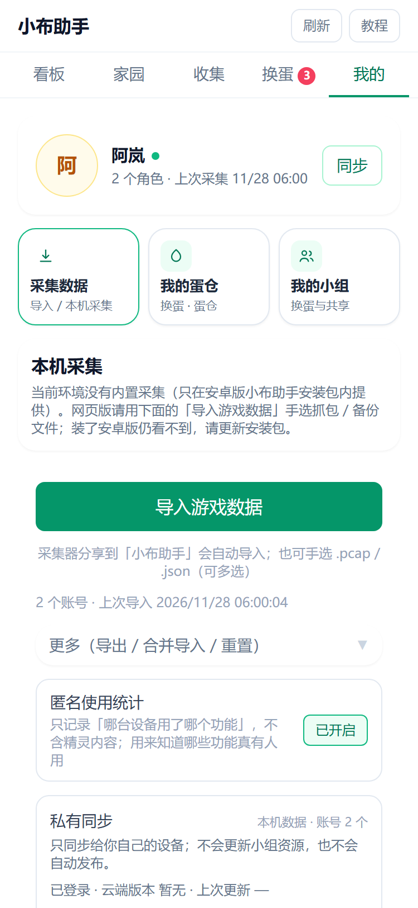
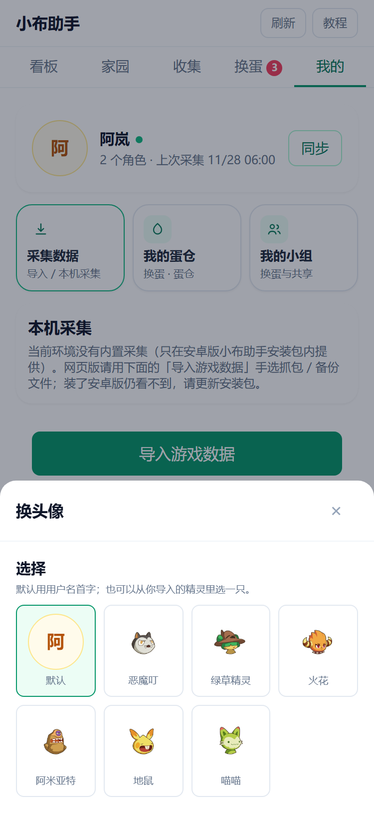
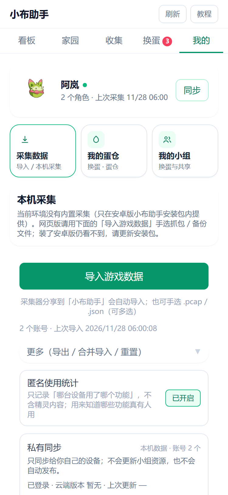

390 版：[默认](preview/AV1-实现-390-1-默认头像.png)、[弹层](preview/AV1-实现-390-2-换头像弹层.png)、[已设置](preview/AV1-实现-390-3-已设置头像.png)。

复现：`npm run dev -- --port 5237 --strictPort` 另开终端，`node tools/preview/av1/shot-impl.mjs`
→「全部 6 张：弹层有候选、头像已设置、无横向溢出、无页面错误。」

### 与拍板前方案的两处差异

1. 没有加「我的身份 · 资料 · 头像」行——用户选了「点头像直接换」，入口就是头像本身；
   `Profile.tsx` 里点头像即可，弹层内不再重复放置换头像的二级入口。
2. 没有走时间戳成对键：换头像时**立刻 PUT** 整份快照，云端永远是最新那份，下载时只对当前账号「以云端为准」。
   少两个键，也不用担心「改了推不上去」；代价是每次换头像传一次快照（头像值本身只有几十字节）。
