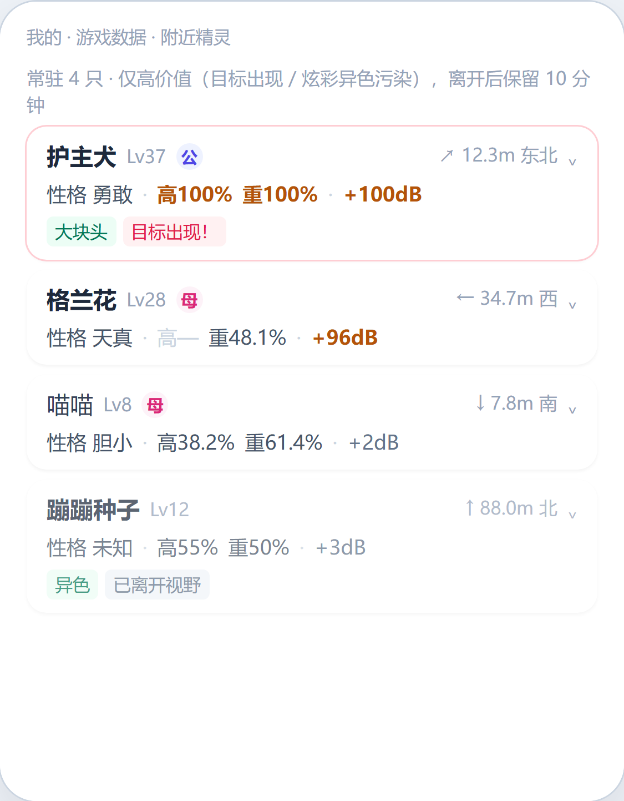
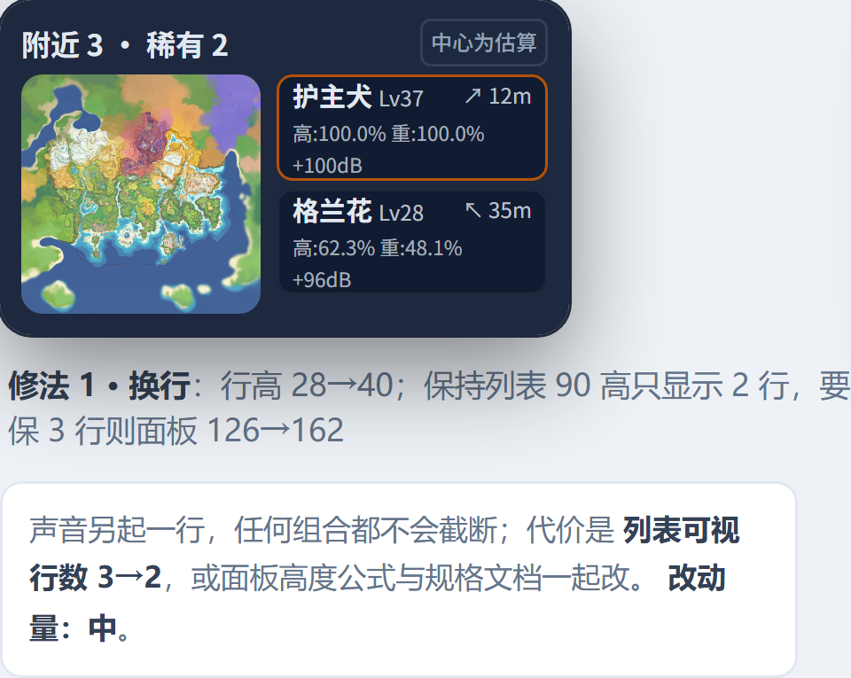
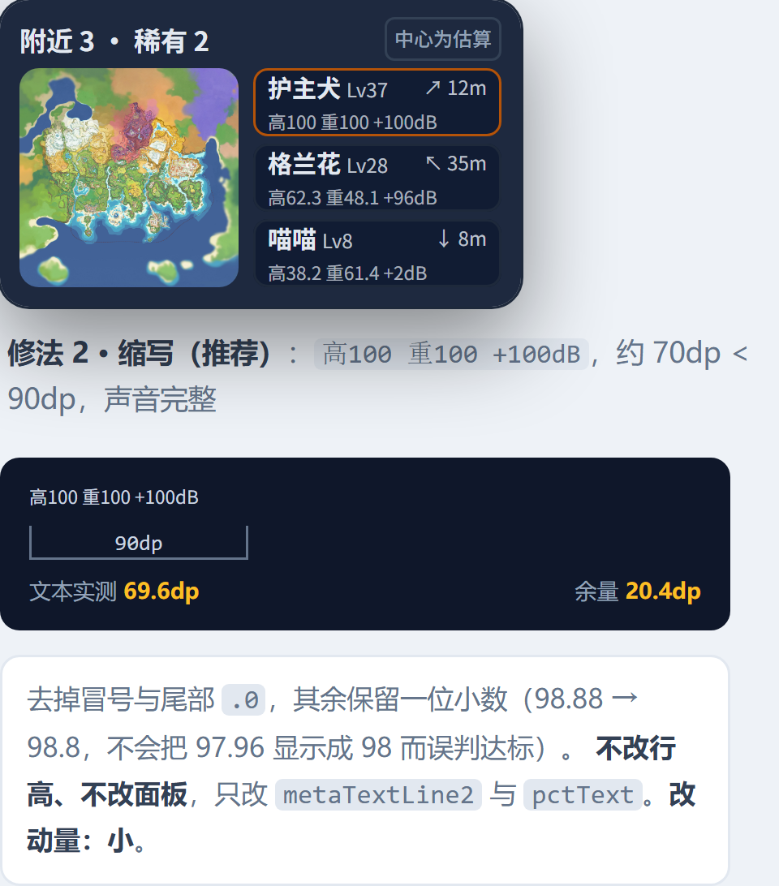
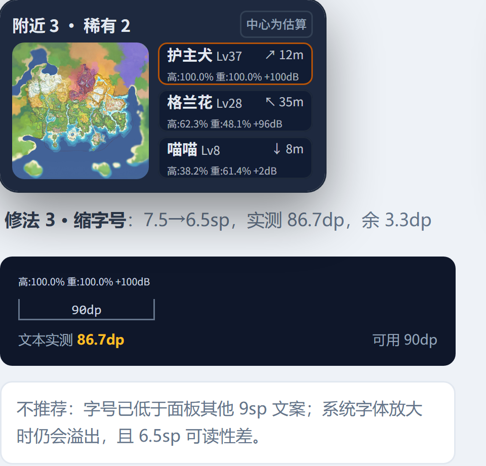

# 方案 · 附近精灵展示优化（U4，2026-11-25）

> **状态（2026-11-25 夜）**：已按批准落 **Web 端**（`Nearby.tsx` + 相关纯函数 + 测试）；**Java 壳端未动**，等壳发布轮。未打包、未发版。
> 可交互稿（改版前方案）：`docs/preview/U4-附近精灵展示优化-方案-2026-11-25.html`；实现记录见 §5。
> 截图：`docs/preview/U4-*.png`。复刻脚本：`tmp-u4/shot.mjs`（Playwright，可用 `node tmp-u4/shot.mjs` 重跑）。

## 0. 结论先说（含 2026-11-25 新口径）

- **问题一**：列表现在只显示「名字 / 等级 / 距离方位 / 性格 / 性别 / 牌子 / 声音 / 提醒」。按新口径改三处：**① 身高、体重百分比一律显示**（不再等大块头 / 小不点，普通精灵也显示）；**② 需求功能下线**，行内不再有「需求中心」chip 和「可叫发需求的人来抓」，截图也不再出现需求；**③ 重复的「可提醒 +100dB」改为「目标出现！」**（+100dB 只在指标行出现一次）。已按 **方案 A** 落地主流布局（主行 + 指标行 + 标签行 + 点开详情），375 下 80px 一行、无横向溢出，平板 416 列同样放得下（实现记录见 §5）。
- **问题二**：已检查并出方案（见 §2）。确认是**单行 + 固定 90dp + 完整格式**导致的尾部截断。`高:100.0% 重:100.0% +100dB` 实测 **100dp**，可用 **90dp**，多 **10dp**，省略号吃掉的就是声音。推荐 **修法 2「缩写」**（`高100 重100 +100dB` 实测 **69.6dp**，余量 **20.4dp**），不改行高、不改面板公式。

## 1. 问题一 · 列表信息不全

### 1.1 现在展示的字段（`src/ui/Nearby.tsx:129-181`，页面列表与全屏列表共用）

| 现在显示 | 位置 | 代码 |
| --- | --- | --- |
| 物种名 | 主行左 | `row.pet.name`（149-150） |
| 等级 | 主行左（12px 灰） | `row.pet.level`（150） |
| 距离 + 八方位 | 主行右 | `point.distanceM` / `point.bearingLabel`（152-154） |
| 已离开视野 | 标签行 | `!row.present`（157） |
| 需求中心（新口径下线） | 标签行 + 整行琥珀描边 | `row.demandHits.length > 0`（144、158-160） |
| 性格 | 标签行蓝 chip | `row.pet.nature`（161-163） |
| 性别 | 标签行紫 chip | `row.pet.gender`（164-166） |
| 牌子（大块头/小不点/炫彩/异色/污染） | 标签行绿 chip | `row.pet.kinds`，**声音牌 high/low 被过滤**（167-171） |
| 声音（dB） | 标签行纯文字 | `row.pet.voiceDb`（173-175） |
| 可提醒 + 原因（与 +100dB 重复） | 标签行玫红文字 | `row.pet.alertReason`（176） |
| 需求完整文案（新口径下线） | 独占一行 | `demandHitLabel()`（178） |
| 是否稀有 | 只体现在名字加粗 | `row.pet.rare`（149） |

> **截图口径**：需求功能已按 2026-11-25 口径下线，所有截图（含「现状」）都不再画需求 chip / 需求文案；**Web 端 demand 路径已删**（`Nearby.tsx` 筛选 / 强提示 / 行内，`overlayPayload` 排序与 reason），只剩 Java `RowTone.DEMAND` 等壳发布轮清（见 §5）。
>
> **核对结果**：当前 `NearbyRowItem` 里**完全没有输出** `heightPct` / `weightPct`，只有 `kinds` 的「大块头 / 小不点」牌子；所以不是「只有体型牌才显示体重」，而是整列都没显示（「大块头」容易被误看成体重）。方案按要求改成**所有行一律显示高/重百分比**。

同一组件也用于全屏列表（`Nearby.tsx:1009-1015`，`dark` 皮肤），所以改一次两处生效。

### 1.2 解码器里还有哪些字段没显示

字段来源以 `src/pcap/wildNearby.ts` / `LiveNearbyPet` / `RetainedEntry` 为准；`LiveNearbyPet` 是展示模型，**不等于**解码器的全部字段。
「首次出现 / 最近看到」是常驻列表自己的会话时间（本局第一次 / 最后一次看到），**不是游戏刷新时间**；其余为解码器字段。

| 字段 | 来源（真实字段） | 现在 | 建议 | 备注 |
| --- | --- | --- | --- | --- |
| 物种名 | `WildPet.name`（wildNearby.ts:123） | ✅ | 主行 | — |
| 等级 | `raw.level`（:24） | ✅ | 主行 `Lv37` | 现在写「37级」，改名后统一 |
| 性别 | 宠物记录回填 `gender`（:128） | ✅ | 主行 `♂/♀` | 野生实体本身不带，没抓到记录就留空 |
| 性格 | 宠物记录回填 `nature`（:127） | ✅ | 次行「性格 勇敢」 | 同上 |
| 声音 | `raw.voiceDb`（:28） | ✅ | 次行 `+100dB` | ±96 以上标达标色 |
| **身高百分比** | `heightPct`（:114，`heightPercentOf`） | ❌ | 次行 `高100%` | **一律显示**；图鉴缺身高区间时为 null，显示 `高—` |
| **体重百分比** | `weightPct`（:111，`weightPercentile`） | ❌ | 次行 `重100%` | **一律显示**，不再等大块头 / 小不点；缺区间时为 null |
| 体型牌 | `kinds` 的 `big/small`（rareRules.ts:60） | ✅ | 标签行 | 需体重 + 身高同时 ≥98 / ≤2 |
| 声音牌 | `kinds` 的 `high/low`（rareRules.ts:64） | ⛔ 有意过滤 | 不显示文字 | dB 已表达；代码在 167 行显式过滤 |
| 炫彩 / 异色 / 污染 | `kinds`（rareRules.ts:55-57） | ✅ | 标签行 | — |
| 是否稀有 | `rare = kinds.length > 0`（:130） | 间接 | 详情「稀有 是/否」 | 不再单独占主行 |
| 目标提示 | `alertReason`（rareRules.ts:82） | ✅（与 +100dB 重复） | 标签行「目标出现！」 | 不再拼 +100dB；+100dB 只在指标行出现一次 |
| 需求命中 | `demandHits`（demandMatch.ts） | ⛔ 新口径下线 | 不展示 | 代码仍保留匹配/筛选（`Nearby.tsx:758-786`、`overlayPayload.ts`），范围见 §3 |
| 距离 / 方位 | `RadarPoint`（nearbyRadar.ts:58-79） | ✅ | 主行右侧 | — |
| 是否在视野 | `RetainedEntry.present`（nearbyRetain.ts:18） | ✅ | 标签行 | — |
| **首次出现** | `firstSeenAt`（nearbyRetain.ts:16） | ❌ | 详情 `12:03:11` | 可格式化成「2 分钟前」 |
| **最近看到** | `lastSeenAt`（:17） | ❌ | 详情 `12:04:05` | — |
| **世界坐标** | `pos.x / pos.y`（wildNearby.ts:32） | ❌ | 详情 `(1024, -356)` | 排障、对地图有用 |
| 物种编号 | `petId / cfgId`（:20/22） | ❌ | 详情 `#3002` | 排障用，可折叠 |
| 原始身高 / 体重 | `WildPet.height / weight`（:25-26） | ❌ | 需确认 | **解码器有 cm / g，但 `inspectCapture.ts:62-67` 只搬了百分比**，要显示得先给 `LiveNearbyPet` 加字段 |
| 是否已收集 | 无此字段 | ❌ | 需确认 | 只能按物种粗判（同种另一只也会误报），建议本轮不做 |

> 「体重」用户说的是可展示信息：**百分比是现成的、可靠的**；kg 原值解码器有（见「原始身高 / 体重」一行），但没进展示模型，要显示得先补字段。
> 新口径下高/重**不再跟体型牌绑定**：普通精灵（如 38.2% / 61.4%）也显示；「大块头 / 小不点」只作为达标牌子保留。
> 悬浮窗（壳端）本来就是 `heightPct` / `weightPct` 有值就显示，不分体型牌（`NearbyOverlayModel.java:408-414`）；这次要改的是**页面列表**。

### 1.3 方案 A（推荐）：主行 + 指标行 + 标签行 + 点开详情

设计原则：**手机 375 能扫读，一行只放一类信息**。

- **主行**：`物种名 · Lv · 性别` ｜ 右侧 `↗ 12.3m 东北`。
- **指标行**：`性格 勇敢 · 高100% 重100% · +100dB`，375 下不换行；**高/重所有精灵都显示**，普通精灵也一样。
- **标签行**（有才显示）：`目标出现！` / `大块头` / `异色` / `已离开视野`；没有就不占行。**不再有「需求中心」和需求文案**。
- **点开详情**：全量 14 项（身高、体重、声音、性别、性格、稀有、目标、首次、最近、坐标、距离、状态、编号、牌子），选中行展开，其余行不动。
- 达标色：高/重 ≥98 或 ≤2、声音 ≥96 / ≤-96 用琥珀色加粗；缺失值显示灰色 `高—`，不伪造。
- **目标出现！**：`alertReason` 非空时显示一个玫红 chip；`+100dB` 不再重复写第二遍（指标行已有）。已离开视野的目标仍保留这枚 chip，另加「已离开视野」。

> 这里的「目标出现！」指**可提醒条件命中**（`rareRules.ts:82`：±100dB，或体型牌 + 声音牌），**不是**页面上的「蹲守目标」名单（`nearbyTargetStore`）；两者文案不要混用。

为什么不是把字段都塞进现在的 chips 行：去掉需求后，375 下现状 4 条都是 **59px**；如果只在现有 chips 行补高/重（方案 C），第 1 条会涨到 **81px** 并换行（见 C 截图），且仍然没有首次 / 坐标 / 牌子以外的时间信息。

### 1.4 截图 · 现状 vs 改进后（375 / 390 / 平板）

**现状 375**（已按新口径去掉需求 UI；4 条样例：目标 + 双满分 / 缺身高 / 普通精灵 / 已离开的异色。注意第 1 条 `+100dB` 和「可提醒 · +100dB」重复）


**改进后 375**



**390 现状 / 改进后**

| 现状 | 改进后 |
| --- | --- |
|  |  |

**平板 768**（`Profile.tsx:122` 仍是 `max-w-md`：容器 448、内容 416；列表不拉宽）

| 现状 | 改进后 |
| --- | --- |
|  |  |

**展开态（375）**


### 1.5 备选方案

| 方案 | 做法 | 优点 | 缺点 | 截图 |
| --- | --- | --- | --- | --- |
| **A（推荐）** | 两行常显 + 标签行 + 点开详情 | 375 扫读快，信息全在，增量小 | 多一点击 | 见上 |
| B | 四行常显（主行/指标/牌子/时间坐标），不展开 | 不用点，一眼全 | 每行约 97px，一屏只看 4~5 只；噪音大 |  |
| C | 只在现有 chips 行补 `高xx%`、`重xx%`，并把可提醒换成目标出现 | 改动最小（~15 行） | 第 1 条 81px 且换行，仍没有时间/坐标 |  |

### 1.6 边界情况

| 情况 | 表现 |
| --- | --- |
| 身高百分比缺失（图鉴无区间） | 显示灰色 `高—`，体重/声音照常，不隐藏整行 |
| 普通精灵（非大块头 / 小不点） | **高/重照常显示**（如 `高38.2% 重61.4%`），只是不亮达标色、没有体型牌 |
| 性格/性别缺失（没回填到宠物记录） | 性别徽章不渲染；次行「性格 未知」（灰） |
| 名字很长 | 名字 `ellipsis`，等级/性别/距离/箭头不缩（与现在的主行规则一致） |
| 高100% + 重100% + 声音 + 目标出现 + 异色/已离开同时出现 | 375 实测：主行 1 行、指标行 1 行、标签行 1 行，行高 **80px**；不溢出（`overflowX=0`） |
| 目标出现但已离开视野 | 标签行同时显示「目标出现！」+「已离开视野」，整行 `opacity .72`；首次/坐标仍可展开看 |
| 全屏列表（深色） | 同一组件，详情面板要同时给 `dark` 配色；改动里单独算 ~20 行 |

### 1.7 改动量与测试影响

| 改动 | 文件 | 量级 | 现有测试 |
| --- | --- | --- | --- |
| 方案 A（高/重一律显示 + 目标出现 + 展开） | `src/ui/Nearby.tsx`（`NearbyRowItem` + 展开状态） | +100~130 行 | **已落**；新增 5 条测试，9 个测试文件 / 120 条全过（§5.2） |
| 只做方案 C | 同上 | +15~20 行 | 未采用；C 会让第 1 条 81px 换行，已否 |
| **需求整体下线** | `Nearby.tsx`、`nearbyFilterStore`、`nearbyTargetStore`、`nearbyRetain`、`overlayPayload`、`useNearbyOverlayPush`；Java `RowTone.DEMAND` 留到壳发布轮 | 中（Web 已落） | **已改并全过**：删需求筛选 / 强提示 / demand 用例；Java 未动 |
| 原始 kg / cm（可选） | `captureProgress.ts`、`inspectCapture.ts`、`wildNearby.ts`、`overlayPayload.ts` | +15 行 | 会影响快照结构，需补测试；**需确认后再做** |

> 需求已按「整体下线」落地 Web 端，不再保留「能筛需求、行里看不出」的中间态；壳端 `RowTone.DEMAND` 等壳发布轮一起清。
> 展开详情按需渲染（`open` 才挂 DOM），避免隐藏文本让 `getByText` 重复命中。

## 2. 问题二 · 悬浮窗「高100% 重100%」声音显示不全

### 2.1 复现

组合：`高:100.0% 重:100.0% +100dB`（身高、体重都满分 + 声音）。复刻面板（214dp，3× 输出）第二行显示：


第二行实际渲染成 `高:100.0% 重:100.0% +1…`，**+100dB 只剩 `+1…`**，与用户描述一致。

### 2.2 代码定位与原因

> PC 小窗的列表只渲染名字 + 距离（`desktop/overlay/overlay.js:83-87`），不含高/重，所以这个截断只发生在安卓悬浮面板（带小地图那份）。

| 位置 | 代码 | 作用 |
| --- | --- | --- |
| `NearbyOverlayModel.java:408-414` | `metaTextLine2()`：`"高:" + pctText(heightPct)`、`"重:" + pctText(weightPct)`、`voiceText()` 用空格拼 | 生成完整一行 |
| `NearbyOverlayModel.java:367-373` | `pctText()` 固定一位小数 + `%` | `100` → `100.0%`（6 个字符）、`0.29` → `0.2%`（只截断不四舍五入） |
| `NearbyOverlayModel.java:417-421` | `voiceText()` → `+100dB` | 不能省 dB |
| `NearbyOverlayModel.java:40` | `LIST_WIDTH = 102` | 列表固定 102dp |
| `NearbyPanelController.java:817` | `lines.setPadding(dp(6), 0, dp(6), 0)` | 左右各 6dp → 文本宽 **90dp** |
| `NearbyPanelController.java:844-848` | `line2.setSingleLine(true)` + `setEllipsize(TextUtils.TruncateAt.END)` | **单行 + 尾部省略**，没有第二条路 |
| `NearbyPanelController.java:815-816` | 第二行高度只有 12dp | 即使允许换行也放不下第二行 |

**实测（复刻浏览器，同一字体栈；默认字体缩放 1.0）**：

| 文本 | 宽度 | 可用 | 结果 |
| --- | --- | --- | --- |
| `高:100.0% 重:100.0% +100dB`（现状） | **100dp** | 90dp | 超 10dp，尾部被吃 |
| `高:100.0% 重:100.0% -100dB`（负分贝） | 98.5dp | 90dp | 同样截断 |
| `高:62.3% 重:48.1% +96dB`（普通） | 87.6dp | 90dp | 只剩 2.4dp，字宽一变就截 |
| `高100 重100 +100dB`（修法 2） | **69.6dp** | 90dp | 余量 20.4dp |
| `高100 重100 -100dB`（修法 2 负分贝） | 68dp | 90dp | 余量 22dp |
| `高:100.0% 重:100.0% +100dB` @6.5sp（修法 3） | **86.7dp** | 90dp | 余量仅 3.3dp |

> 根因不是「声音太长」，而是**整行用了完整格式 + 单行省略**；`pctText` 的 `100.0%` 和 `高:`/`重:` 占了 30dp 的可省空间。

### 2.3 修法对比

| 修法 | 做法 | 结果 | 代价 | 截图 |
| --- | --- | --- | --- | --- |
| 1 · 换行 | 第二行只放 `高/重`，声音另起一行；行高 28→40 | 任何组合都不截断 | 列表 90 高只剩 2 行可见；要保 3 行则面板 126→162，**面板高度公式/规格一起改** |  |
| **2 · 缩写（推荐）** | `高100 重100 +100dB`：去 `:` 和尾部 `.0`，保留一位小数 | 69.6dp，声音完整 | 只改文本生成；**不改行高、不改面板** |  |
| 3 · 缩字号 | 7.5sp → 6.5sp | 86.7dp，勉强放下 | 已小于面板 9sp 文案；系统字体放大仍会溢出；可读性差 |  |

**推荐修法 2**，并建议加一层兜底：第二行改成横向 `LinearLayout`，左侧高/重 `weight=1` 可省略，右侧声音 `wrap_content` 不省略——这样即使以后加字段，声音也永远完整。只做「缩写」实现最小；加兜底再 +20~25 行。

**小数口径**：`pctText` 的「只截断不四舍五入」必须保留（97.96 不能显示成 98，否则会被当成达标）。缩写只去掉 `.0`：`100.0%`→`100`、`98.88%`→`98.8`、`0.29%`→`0.2`。

### 2.4 极端组合

高/重满分 + 目标出现 + 稀有描边 + 未来的「已收集」：


- 稀有描边、目标红条都**不占文字宽度**；需求已下线，不再有玫红需求底；
- 7dp 的「已收集」图标放在第二行右下角，仍能放下（`69.6 + 7 + 间距 < 90`）；
- **当前协议没有「已收集」字段**，这张图里的 ✓ 是假设，不要当成已实现；
- 如果「已收集」非要用文字（3 个字 22.5dp），90dp 一定放不下，只能加行或换布局。

### 2.5 改动量与测试影响

| 改动 | 文件 | 量级 | 现有测试 |
| --- | --- | --- | --- |
| 修法 2（推荐） | `NearbyOverlayModel.java` 新增 `pctCompact` + 改 `metaTextLine2` | +10~15 行 | `NearbyOverlayModelTest.java:220` 期望值要改（`高12.3 重0.2 +15dB`）；`pctText` 的 288-293 不用动 |
| 声音不截断兜底 | `NearbyPanelController.java:844-848` 改成两个 TextView | +20~25 行 | 无单测（纯 View），需真机/截图验收 |
| 修法 1（换行） | 上面 + `ROW_HEIGHT`/面板高度/规格文档 | +40~60 行 | `panelHeight` / `listHeight` 用例（`NearbyOverlayModelTest.java:160-199`）要跟着改 |
| 修法 3 | 只改 `setTextSize` 7.5→6.5 | 1 行 | 无 | 

> `docs/手机悬浮窗-面板规格.md:82`（1.3.1 第 2 行示例）也要同步改成缩写格式。

## 3. 待确认

1. **是否已收集**：解码器没有个体级字段；按物种匹配会把「已有同种另一只」误判成已收集。建议不做，或明确「按物种」口径再做。
2. **是否显示原始 kg / cm**：`WildPet` 有 `height`（cm）/`weight`（g），但 `inspectCapture.ts:62-67` 没搬进 `LiveNearbyPet`。要显示需要改展示模型与 payload（会动快照结构和测试）。
3. **需求下线的范围（已拍板）**：整体下线，Web 已落（筛选 / 强提示 / 行内 / overlay reason）；Java `RowTone.DEMAND` 与壳端文案等壳发布轮一起清。`demandMatch.ts` / `useDemandCenter.ts` 已无引用，本轮未删文件，后续可连测试一起清。
4. **列表默认展开哪条**：建议默认全部收起，只保留「点开」；目标出现 / 稀有行是否默认展开，需要拍板。
5. **平板是否需要更宽列表**：现在 `Profile` 固定 `max-w-md`，416 内容宽；如果平板要双列，属于另一个改版，不在本轮。

## 4. 验收清单（Web 已落；Java 待壳发布轮）

- [x] 375 / 390 / 平板 各出一条含「高100% 重100% +100dB + 目标出现！+ 异色/已离开」的样例，均不换行溢出。
- [x] 普通精灵（非大块头 / 小不点）也显示高/重，缺值显示 `—`。
- [x] 缺身高/缺性格/已离开视野三种边界与截图一致。
- [x] 展开后能看到：首次、最近、坐标、编号、稀有、目标、牌子。
- [x] 行内不再出现「需求中心」「可叫发需求的人来抓」；「可提醒」不再重复 +100dB。
- [ ] 悬浮窗 `高:100.0% 重:100.0% +100dB` 不再截断（改为 `高100 重100 +100dB`，声音完整）——**Java 待壳发布轮，本轮未动**。
- [x] 普通值 `98.8` / `0.2` / 缺失 `—` 的显示口径一致，97.96 不显示成 98。
- [x] `Nearby.test.tsx` 等相关用例通过；新增边界用例（§5.2）。

## 5. 实现记录（2026-11-25 夜）

### 5.1 已落 Web 端

| 文件 | 改动 |
| --- | --- |
| `src/ui/Nearby.tsx` | 行改成「主行 + 指标行 + 标签行 + 点开详情」；`高xx% 重xx%` 所有行都显示，缺值 `—`；`目标出现！` 替代「可提醒 · +100dB」；需求 chip / 需求文案 / 需求排序 / 需求 filter 全删；详情 14 项（含首次 / 最近 / 坐标 / 编号 / 牌子） |
| `src/ui/Nearby.test.tsx` | 删需求 mock 与 3 条需求用例；新增 5 条：普通精灵显示高/重、缺身高 `高—`、目标出现只出现一次、点开详情、需求入口整体下线 |
| `src/nearby/nearbyFilterStore.ts` | `NearbyFilter` 去掉 `'demand'`；旧 localStorage 的 `demand` 归一成 `all`；`nearbyFilterAllows` 去掉 demandHits 参数 |
| `src/nearby/nearbyTargetStore.ts` | `nearbyRangeAllows` 去掉 demandHits 参数 |
| `src/pcap/nearbyRetain.ts` | `RetainedEntry` / `RetainClassify` 去掉 demandHits；`isHighValuePet(pet)` 不再接受命中列表 |
| `src/nearby/overlayPayload.ts` | `isOverlayTarget` / `overlayHitReason` 去掉 demand；payload 不再接收 / 输出 demand；排序去掉 demand 优先级 |
| `src/nearby/useNearbyOverlayPush.ts` | 删需求中心轮询、命中 map 与 60s 刷新；推送只带 snapshot / filter / target / targets |
| `src/ui/tour.ts` | 附近教程文案去掉「需求」筛选与「可主动提醒」，改成「目标出现」 |
| 对应测试 | `nearbyRetain` / `nearbyTargetStore` / `overlayPayload` / `useNearbyOverlayPush` 同步删需求用例、改签名 |

**未动**：`android-shell`（`NearbyPanelController.java` / `NearbyOverlayModel.java`）按批准留到壳发布轮；`RowTone.DEMAND` 仍在 Java 里，网页侧已不再产生 `reason: 'demand'`，壳端会落到默认 tone。
**遗留**：`src/pcap/demandMatch.ts` 与 `src/ui/useDemandCenter.ts` 现在没有引用（只剩各自的测试），本轮没有删文件；下次清理可连测试一起删。

### 5.2 验证（真实输出）

```text
$ npx tsc -b
(无输出，退出码 0)

$ npx vitest run src/ui/Nearby.test.tsx src/ui/NearbyMap.test.ts \
    src/ui/NearbyBattleCard.test.tsx src/pcap/nearbyRetain.test.ts \
    src/nearby/nearbyTargetStore.test.ts src/nearby/overlayPayload.test.ts \
    src/nearby/useNearbyOverlayPush.test.tsx src/ui/tour.test.ts src/ui/TourOverlay.test.tsx

 Test Files  9 passed (9)
      Tests  120 passed (120)
```

> 测试里仍有既有的 `act(...)` 警告（`Nearby.tsx:295` 附近的异步刷新），本轮未新增。

### 5.3 截图对应

- 收起布局：`U4-375-列表-改进后.png` / `U4-390-列表-改进后.png` / `U4-768-列表-改进后.png`
- 展开详情：`U4-375-列表-改进后-展开.png`
- 悬浮窗：`U4-悬浮窗-现状-截断.png`（复现）、`U4-悬浮窗-修法2-缩写.png`（推荐，Java 待壳发布轮）

截图是按实现后的组件几何复刻（未改真机数据注入路径），不是真机抓屏；代码行为以 5.2 的测试输出为准。
